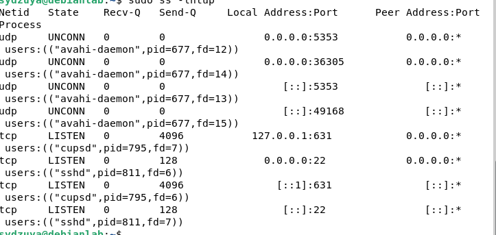
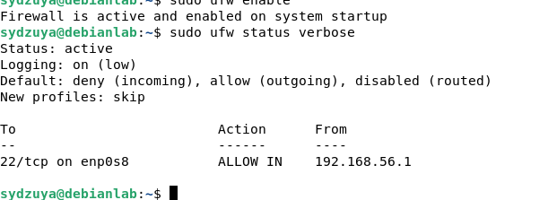
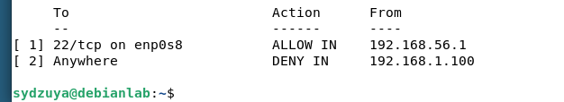
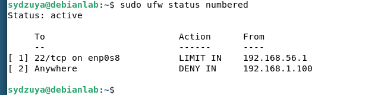
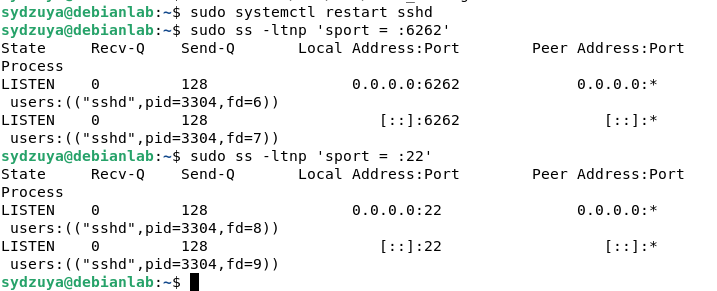
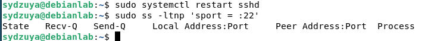
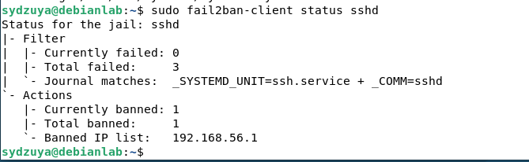
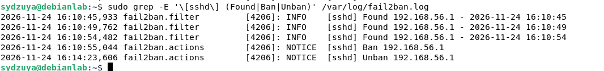

# debian-security-lab

Пошаговая настройка UFW и защиты SSH с помощью Fail2ban на Debian 13.7. В лаборатории перенёс SSH с порта `22` на `6262`, проверил блокировку после трёх неверных паролей и восстановил доступ вручную.

При повторении замените `labuser` на имя своей учётной записи Debian. Адреса и имя интерфейса в командах относятся к этому стенду.

## Подготовка стенда

В лаборатории использованы Debian 13.7 (Trixie) в Oracle VirtualBox и Windows 11 в качестве хоста. Сеть ВМ, первый вход по SSH и права `sudo` описаны в первом проекте. [Базовая настройка Debian](https://github.com/sydzuya/debian-server-setup).

| Параметр | Значение на стенде |
| --- | --- |
| Интерфейс Host-only в Debian | `enp0s8` |
| Адрес Debian для SSH | `192.168.56.101/24` |
| Адрес Windows в Host-only | `192.168.56.1` |
| Учебный адрес для правила DENY | `192.168.1.100` |
| Порт SSH в начале работы | `22/tcp` |
| Итоговый порт SSH | `6262/tcp` |

Команды Bash выполняются в Debian с правами `sudo`. Для подключения и проверки доступа используйте терминал Windows. Настройка начинается с работающего SSH на порту `22`.

## Настройка UFW

Для команд в этом разделе нужна учётная запись с правами `sudo`. [Настройка `sudo` в первом проекте](https://github.com/sydzuya/debian-server-setup#права-sudo-через-visudo).

В консоли VirtualBox установил UFW.

```bash
sudo apt install ufw
```

При повторении задайте базовую политику для новых соединений. Входящие подключения разрешаются отдельными правилами, исходящие соединения разрешены по умолчанию.

```bash
sudo ufw default deny incoming
sudo ufw default allow outgoing
```

Перед добавлением правила проверил слушающие сокеты командой `sudo ss -lntup`. Процесс `sshd` слушал `22/tcp` на IPv4 и IPv6.



Добавил правило для подключения из Windows перед включением фильтра.

```bash
sudo ufw allow in on enp0s8 proto tcp from 192.168.56.1 to any port 22
sudo ufw enable
sudo ufw status verbose
```

UFW показал `Status: active`, запрет входящих и разрешение исходящих соединений по умолчанию. Правило `22/tcp on enp0s8` разрешает входящий SSH с IPv4-адреса Windows `192.168.56.1` через Host-only.



После включения UFW я открыл новый SSH-сеанс из Windows и успешно вошёл в Debian.

### Блокировка отдельного IP

Добавил правило для учебного адреса `192.168.1.100` и проверил список правил с номерами.

```bash
sudo ufw deny from 192.168.1.100
sudo ufw status numbered
```

В списке появилась строка `DENY IN` для этого источника.



### Проверка LIMIT на исходном порту

На порту `22` проверил действие `LIMIT` для подключений из Windows.

```bash
sudo ufw limit in on enp0s8 proto tcp from 192.168.56.1 to any port 22
sudo ufw status numbered
```

Действие изменилось на `LIMIT IN`. Обычный вход по SSH после изменения прошёл. Для нового порта `6262` в следующем разделе использовал действие `ALLOW`.



## Перенос SSH на порт 6262

1. **В консоли Debian в VirtualBox** проверил, занят ли выбранный TCP-порт.

   ```bash
   sudo ss -ltnp 'sport = :6262'
   ```

   В выводе были только заголовки, слушающих сокетов на этом порту не было.

2. Разрешил подключения из Windows к новому порту через Host-only.

   ```bash
   sudo ufw allow in on enp0s8 proto tcp from 192.168.56.1 to any port 6262
   ```

3. Открыл конфигурацию SSH и на время проверки указал оба порта.

   ```bash
   sudo nano /etc/ssh/sshd_config
   ```

   ```text
   Port 22
   Port 6262
   ```

4. Проверил синтаксис, применил настройки и посмотрел слушающие сокеты.

   ```bash
   sudo sshd -t
   sudo systemctl restart sshd
   sudo ss -ltnp 'sport = :6262'
   sudo ss -ltnp 'sport = :22'
   ```

   Процесс `sshd` слушал оба порта на IPv4 и IPv6.

   

5. **В новом окне Windows PowerShell** проверил вход через новый порт. Ключ `-p` задаёт порт назначения.

   ```powershell
   ssh -p 6262 labuser@192.168.56.101
   ```

   Вход с паролем прошёл.

6. После проверки входа удалил строку `Port 22` из `/etc/ssh/sshd_config`, оставив `Port 6262`. Перезапустил службу и проверил старый порт в Debian.

   ```bash
   sudo systemctl restart sshd
   sudo ss -ltnp 'sport = :22'
   ```

   В выводе остались только заголовки.

   

   При проверке из Windows команда `ssh -p 22 labuser@192.168.56.101` вернула `Connection refused`.

Для удаления прежнего правила `LIMIT` из UFW используется команда, которая указывает все параметры этого правила.

```bash
sudo ufw delete limit in on enp0s8 proto tcp from 192.168.56.1 to any port 22
```

## Защита SSH с помощью Fail2ban

Установил Fail2ban и создал файл локальной конфигурации в Debian.

```bash
sudo apt install fail2ban
sudo nano /etc/fail2ban/jail.local
```

```ini
[sshd]
enabled = true
port = 6262
backend = systemd
banaction = ufw
maxretry = 3
findtime = 600
bantime = 3600
```

Настройка `sshd` отслеживает ошибки входа в системном журнале. При трёх ошибках с одного IP за десять минут Fail2ban добавляет через UFW блокировку этого адреса на час. [Справка по настройкам Fail2ban](https://manpages.debian.org/trixie/fail2ban/jail.conf.5.en.html).

Проверил конфигурацию, перезапустил службу, включил автозапуск и посмотрел статус защиты SSH.

```bash
sudo fail2ban-client -t
sudo systemctl restart fail2ban
sudo systemctl enable fail2ban
sudo fail2ban-client status sshd
```

Проверка конфигурации вернула `OK: configuration test is successful`. Статус показал запущенную настройку защиты `sshd` с чтением системного журнала.

### Проверка блокировки и восстановления доступа

Для теста держал открытой консоль Debian в VirtualBox. **Из Windows** начал SSH-подключение на `6262` и три раза ввёл неправильный пароль.

```powershell
ssh -p 6262 labuser@192.168.56.101
```

В консоли Debian повторно выполнил `sudo fail2ban-client status sshd`. Счётчик `Total failed` стал равен `3`, `Currently banned` — `1`, а в `Banned IP list` появился адрес Windows `192.168.56.1`.



Новое подключение из Windows к `6262` завершилось сообщением `Connection timed out`. Снял тестовую блокировку через консоль Debian в VirtualBox.

```bash
sudo fail2ban-client set sshd unbanip 192.168.56.1
```

Команда вернула `1`. После этого новый вход из Windows с правильным паролем прошёл.

Посмотрел последние строки журнала и отобрал события SSH для отчёта.

```bash
sudo tail -n 20 /var/log/fail2ban.log
sudo grep -E '\[sshd\] (Found|Ban|Unban)' /var/log/fail2ban.log
```

Три записи `Found` соответствуют ошибкам входа, `Ban` — добавлению блокировки, `Unban` — её снятию.



## Конфигурационные файлы

- Настройки SSH-клиента для итогового порта `6262`. Замените `labuser` своим именем и выполните `ssh -F configs/ssh-client.conf debianlab` из корня репозитория. [Конфигурация SSH-клиента](configs/ssh-client.conf).
- Настройки Fail2ban для файла `/etc/fail2ban/jail.local`. [Конфигурация Fail2ban](configs/jail.local).
